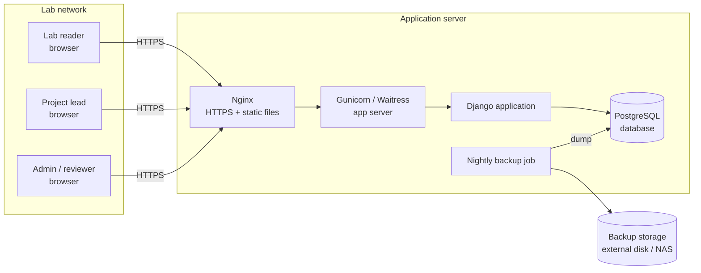
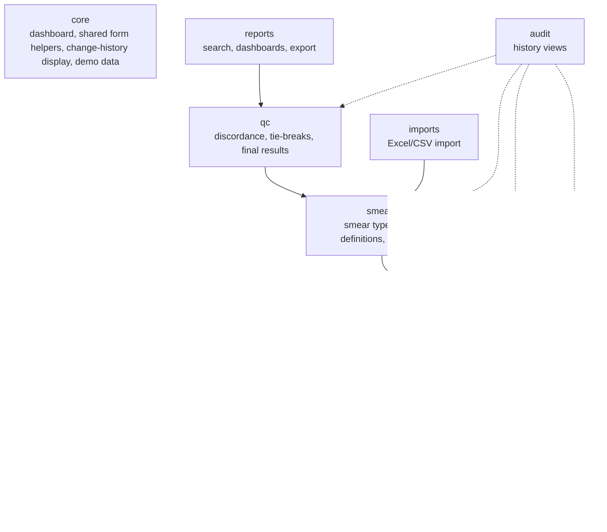
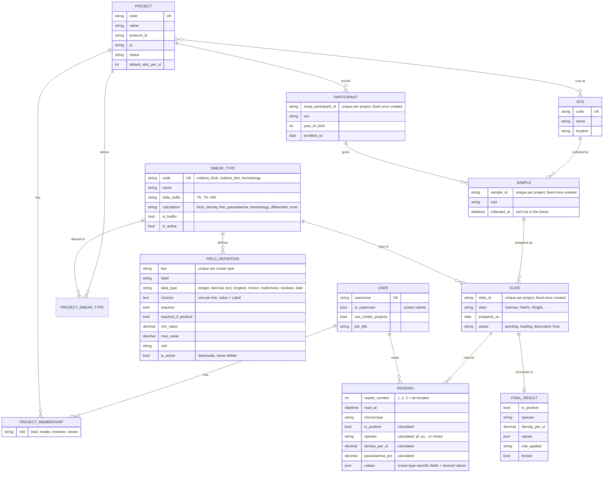
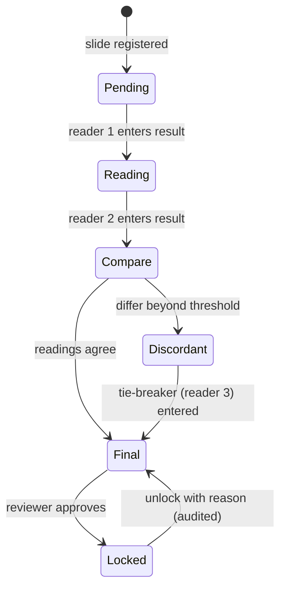
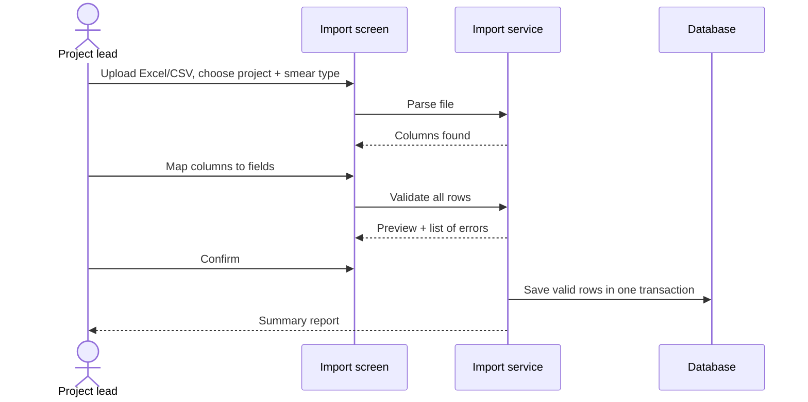

# System Architecture — Integrated Blood Smear System

| | |
|---|---|
| **Version** | 0.3 (draft) |
| **Date** | 2026-11-11 |
| **Related** | [01-requirements.md](01-requirements.md) |

## 1. Overview

The system is a **web application hosted on the institution's local network**. Staff use it through a web browser; there is nothing to install on their PCs. A single server holds the application and the database, so all projects share one source of truth.



## 2. Technology choices

| Layer | Choice | Why |
|---|---|---|
| Language | Python 3.12+ (developed on 3.14) | Widely known in research settings; strong data tooling (pandas for import/export) |
| Web framework | Django 6.1 | Built-in user accounts, permissions, admin interface, forms and database migrations |
| Database | PostgreSQL 16 (production), SQLite (development) | Reliable, free; JSONB support for flexible smear fields with indexing |
| User interface | Django templates + HTMX + Bootstrap 5 (+ Bootstrap Icons) | Dynamic forms (fields change with smear type) without a separate front-end app to maintain. Library files are stored in `static/vendor/`, so the app needs no internet |
| Audit trail | `django-simple-history` | Keeps a full history of every change to each record |
| Import/export | pandas + openpyxl | Reads and writes Excel and CSV |
| Web server | Nginx + Gunicorn (Linux) or Waitress (Windows) | Standard, stable production setup |

## 3. Application structure

The Django project is split into apps, each owning one area:

Built so far: `core`, `accounts`, `projects`, `samples` (Phase 1) and `smears` (Phase 2). The others arrive in later phases.



Project membership lives in `projects` (not `accounts`), so `accounts` stays independent and `projects` depends on it, never the reverse.

```
bsintegratedsystem/
├── docs/                 # requirements, architecture, user guides
├── config/               # Django settings, URLs
├── apps/
│   ├── core/             # dashboard, shared helpers, seed_demo command
│   ├── accounts/
│   ├── projects/         # includes permissions.py: the single place for access rules
│   ├── samples/
│   ├── smears/           # smear types, slides, readings; dynamic.py + calculations.py
│   ├── qc/               # Phase 3
│   ├── reports/          # Phase 4
│   ├── imports/          # Phase 5
│   └── audit/            # Phase 4+ (history pages already exist per record)
├── templates/            # HTML pages, grouped by app
├── static/               # app.css + vendor/ (Bootstrap, HTMX, icons)
└── manage.py
```

Each app keeps its tests in `apps/<app>/tests/`.

### 3.1 Web addresses

| Address | Page |
|---|---|
| `/` | Dashboard |
| `/projects/` · `/projects/new/` | Project list · create |
| `/projects/<code>/` | Project overview (details, members, recent samples) |
| `/projects/<code>/edit/` · `status/` · `history/` | Edit · change status · change history |
| `/projects/<code>/members/add/` | Add a member |
| `/projects/<code>/participants/` | Participants (search) |
| `/projects/<code>/participants/<id>/` | Participant with their samples |
| `/projects/<code>/participants/<id>/samples/new/` | Add a sample |
| `/projects/<code>/samples/` | All samples in the project (search, filter by site) |
| `/projects/<code>/samples/<id>/` | Sample with its slides and results |
| `/projects/<code>/samples/<id>/smears/new/` | Record a smear result (slide + first reading) |
| `/projects/<code>/smears/fields/?smear_type=<id>` | HTMX: result fields for a smear type |
| `/projects/<code>/results/` | All smear results in the project (filter by type, result, species) |
| `/projects/<code>/slides/<id>/` · `edit/` · `history/` | Slide with its readings · edit slide details · history of slide and readings |
| `/projects/<code>/slides/<id>/readings/<id>/edit/` | Edit a reading (recalculates) |
| `/admin/` | Administration (system admins only): users, sites, smear types and their fields |

The project code appears in every address, and every page checks that the record really belongs to that project, so a user can't reach another project's data by editing the address.

## 4. Data model

Built so far: USER, SITE, PROJECT, PROJECT_MEMBERSHIP, PARTICIPANT, SAMPLE (Phase 1); SMEAR_TYPE, FIELD_DEFINITION, PROJECT_SMEAR_TYPE, SLIDE, READING (Phase 2). Every one of them keeps a full change history. FINAL_RESULT arrives in Phase 3.



### 4.1 Flexible smear fields

Different smear types need different fields, and admins must be able to add new ones (FR-9). The design is **hybrid**:

- **Common, frequently searched values** (`is_positive`, `species`, `density_per_ul`) are **real database columns**, so cross-project searches are fast and simple.
- **Type-specific values** (stage counts, differential counts, morphology) go in a **JSON `values` field** validated against that smear type's `FIELD_DEFINITION` rows. PostgreSQL JSONB indexes keep these searchable.

The data-entry form is built at runtime from the field definitions (`apps/smears/dynamic.py`), so a new smear type works without code changes.

Two field keys have special meaning for any smear type, built-in or custom:
- **`result`** (options `positive` / `negative`) fills the searchable `is_positive` column, and switches on "required if positive" fields.
- **`species`** (options `pf`, `pv`, `pm`, `po`, `pk`, `unidentified`) fills the searchable `species` column. Ticking more than one gives `mixed`.

**How a result is saved:**

```mermaid
sequenceDiagram
    actor Reader
    participant Form as Record smear result page
    participant Dyn as Dynamic form (dynamic.py)
    participant Calc as Calculations (calculations.py)
    participant DB as Database

    Reader->>Form: Choose smear type
    Form->>Dyn: HTMX request for that type's fields
    Dyn-->>Form: Fields built from FIELD_DEFINITION rows
    Reader->>Form: Enter values, save
    Form->>Dyn: Check each field (type, limits, required)
    Form->>Calc: Check values make sense together; calculate
    alt problems found
        Calc-->>Form: Messages shown on the right fields; nothing saved
    else all good
        Form->>DB: Save slide + reading (searchable columns + JSON values) in one transaction
    end
```

### 4.2 Calculations

Calculations run on the server whenever a reading is saved or edited, so they're always consistent (`apps/smears/calculations.py`). Each smear type names the calculation it uses.

| Calculation | Formula | Consistency checks |
|---|---|---|
| **Thick density** | `density/µL = asexual parasites ÷ WBCs counted × WBC/µL`, where WBC/µL is the measured count if entered, else the project default, else 8,000. Gametocyte density uses the same formula. | Positive needs parasites or gametocytes counted. Negative can't have parasites, gametocytes or species. Counting gametocytes ticks "gametocytes seen". |
| **Thin parasitaemia** | `parasitaemia % = infected RBCs ÷ RBCs counted × 100` | Infected can't exceed counted. Positive needs infected RBCs or stages. Negative can't have infected RBCs, stages or species. |
| **Hematology differential** | Total of the differential percentages | If any differential is entered, the total must be exactly 100%. |
| **None** (custom types) | — | Only the per-field rules (required, min/max), and "required if positive". |

Densities are stored to 2 decimal places and shown as whole numbers; parasitaemia to 4 decimal places.

## 5. Key workflows

### 5.1 Reading a slide, with quality control



Projects that use only one reader can be configured to go straight from the first reading to **Final**.

**Current state (Phase 2):** every slide is single-reader. Saving the first reading sets the slide to **Final**. Phase 3 adds second readers, discordance checks, tie-breakers and locking.

### 5.2 Importing existing study data



## 6. Security

### 6.1 Who can do what

Rules live in one file, `apps/projects/permissions.py`, and every page goes through it.

| Action | System admin | Lead | Reader | Reviewer | Viewer | Non-member |
|---|:-:|:-:|:-:|:-:|:-:|:-:|
| See the project and its data | ✅ | ✅ | ✅ | ✅ | ✅ | ❌ (page looks like it doesn't exist) |
| Create a new project | ✅ | if "can create projects" is ticked on their account | | | | |
| Edit project details, manage members | ✅ | ✅ | ❌ | ❌ | ❌ | ❌ |
| Register participants and samples | ✅ | ✅ | ✅ | ❌ | ❌ | ❌ |
| Close / archive a project | ✅ | ✅ | ❌ | ❌ | ❌ | ❌ |
| Reopen a closed project | ✅ | ❌ | ❌ | ❌ | ❌ | ❌ |
| Approve/lock results (Phase 3) | ✅ | | | ✅ | | |

- A closed or archived project is read-only for everyone. Only a system admin can reopen it.
- A project always keeps at least one lead. The last lead can't be removed or demoted.
- Participant IDs, sample IDs and project codes can't be changed once created.
- Participants and samples can't be deleted from the screens (data integrity). An admin can do it from Administration if truly needed, and history keeps a record.
- User accounts can't be deleted, only deactivated.

### 6.2 Protections

| Concern | Approach |
|---|---|
| Authentication | Django accounts; passwords at least 10 characters and not common; lockout after repeated failures (planned for Phase 6) |
| Authorisation | Every query is filtered by the user's project memberships; enforced in one shared permission layer, not per screen |
| Transport | HTTPS on the local network (internal certificate) |
| Sessions | Auto-logout after inactivity (default 30 minutes) |
| Privacy | Only study participant IDs are stored; no names or contact details |
| Audit | Every change is recorded by `django-simple-history`; history is read-only in the UI |
| Common web attacks | Django's built-in CSRF, XSS and SQL injection protections |

## 7. Deployment

| Environment | Setup |
|---|---|
| **Development** | Developer PC, SQLite, Django development server |
| **Production** | One server on the local network (Linux preferred; Windows supported), PostgreSQL, Nginx + Gunicorn/Waitress, running as a service that restarts on reboot |

**Configuration** comes from environment variables, so the same code runs in development and production:

| Variable | Purpose | Development default |
|---|---|---|
| `BSIS_SECRET_KEY` | Secret used for sessions and security tokens | Insecure dev key (must be set in production) |
| `BSIS_DEBUG` | Show detailed error pages | `true` (must be `false` in production) |
| `BSIS_ALLOWED_HOSTS` | Server names/addresses the app answers to | `localhost,127.0.0.1` |
| `BSIS_DB_ENGINE` | Set to `postgresql` to use PostgreSQL | SQLite |
| `BSIS_DB_NAME`, `_USER`, `_PASSWORD`, `_HOST`, `_PORT` | PostgreSQL connection | — |
| `BSIS_TIME_ZONE` | Local time zone | `Africa/Kampala` |
| `BSIS_SESSION_TIMEOUT_SECONDS` | Auto-logout after inactivity | `1800` (30 minutes) |

**Backups:** a nightly `pg_dump` copied to separate storage (external disk/NAS), with 30 daily and 12 monthly copies kept. The restore procedure will be documented and tested.

**Scaling:** one server comfortably handles dozens of concurrent users and millions of readings. If needed later, the database can move to its own server without code changes.

## 8. Decisions log

| # | Decision | Reason | Date |
|---|---|---|---|
| D1 | Local-network web app | Works without internet; data stays in-house; no installs on PCs | 2026-11-11 |
| D2 | Django + PostgreSQL | Built-in accounts, admin and migrations; reliable and free | 2026-11-11 |
| D3 | Hybrid columns + JSON for smear fields | Fast cross-project search plus admin-configurable smear types | 2026-11-11 |
| D4 | Server-rendered UI with HTMX | Dynamic forms without maintaining a separate JavaScript app | 2026-11-11 |
| D5 | Project membership lives in the `projects` app | Keeps dependencies one-way (`projects` → `accounts`) | 2026-11-11 |
| D6 | Front-end libraries stored locally in `static/vendor/` | Works with no internet (NFR-2) | 2026-11-11 |
| D7 | Project codes, participant IDs and sample IDs can't change after creation | They link to paper records and slide labels; changing them would break traceability | 2026-11-11 |
| D8 | Non-members get "not found" rather than "not allowed" | Doesn't reveal which projects exist | 2026-11-11 |
| D9 | Sample stores its project directly (as well as via participant) | Sample IDs can be unique per project; cross-project searches stay simple | 2026-11-11 |
| D10 | Calculations live in code and each smear type picks one by name | Formulas need testing and must never be broken by a typo in the admin screen; field lists stay configurable | 2026-11-11 |
| D11 | Built-in types and fields are created by a database migration | Every installation gets identical definitions; field keys used by calculations can't be renamed in admin | 2026-11-11 |
| D12 | Smear types and fields are deactivated, never deleted | Saved readings refer to them; deleting would orphan data | 2026-11-11 |
| D13 | A slide's smear type and ID are fixed once recorded | Its result fields depend on the type; the ID is on the physical slide label | 2026-11-11 |
| D14 | Slide and first reading are recorded on one page | Fewer steps for the common case; Phase 3 adds later readers from the slide page | 2026-11-11 |

## 9. Change log

| Version | Date | Change |
|---|---|---|
| 0.1 | 2026-11-11 | Initial architecture |
| 0.2 | 2026-11-11 | Phase 1 built: added Site entity, permission matrix, web addresses, configuration variables, decisions D5–D9 |
| 0.3 | 2026-11-11 | Phase 2 built: smear type data model, result-saving flow, calculation table, web addresses, decisions D10–D14 |
